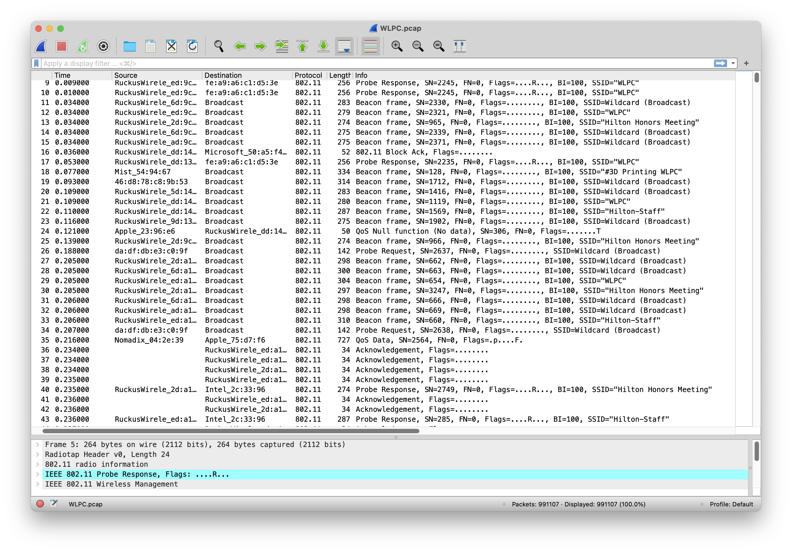
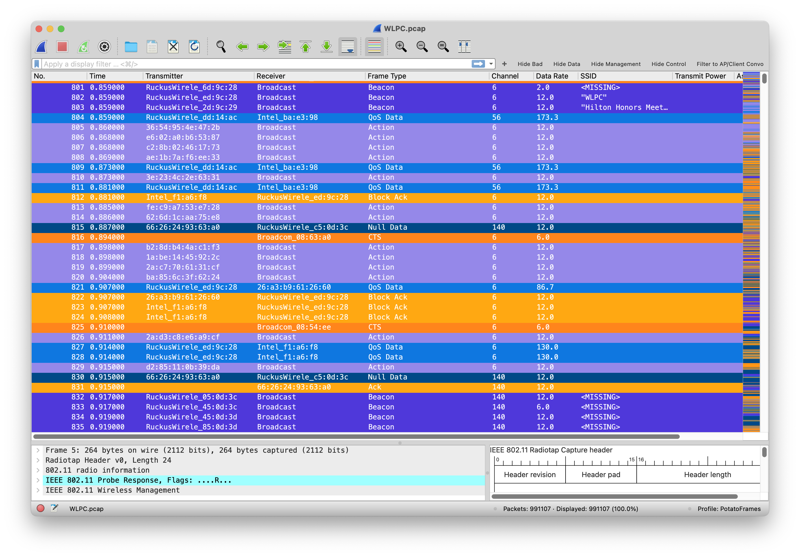
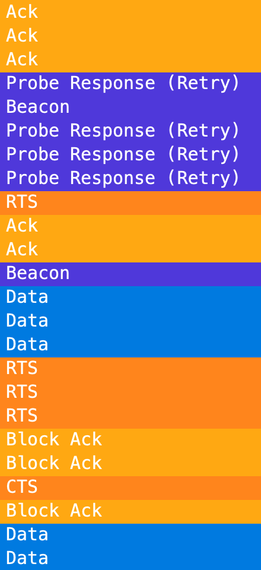
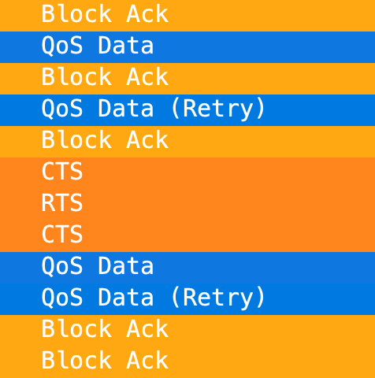

# Introduction

This Wireshark profile is designed to make Wi-Fi packet analysis is designed to focus on simplicity and readability. It transforms Wireshark from a boring white wall of text...

...to a clean and simple UI with industry-standard colors to identify each frame type.

## History

This profile began as a set of coloring rules for Wireshark, based on the packet colors in MetaGeek Eye P.A., [which was released in 2011 or 2012](https://www.youtube.com/watch?v=R8huMmzT_Ww). It began as a set of coloring rules for packets, and was most likely originally built by Trent Cutler.

During my time at MetaGeek from 2012-2018, I bundled it into a configuration profile and posted it on the MetaGeek Knowledgebase.

When I came back to MetaGeek as a Product Owner in 2021, I worked with my UX design Nabil Rahman to design MetaGeek Tonic (now known as The MetaGeek App). He gave me a color pallete, and I chose how to apply them to the specific 802.11 frame types. I did stick with the classic Purple/Management, Orange/Control, and Blue/Data scheme, but with all-new shades and applications to subframe types. I also came up with a hack to use the coloring rule column to precisely name each subframe type. Then, I then applied this back to the Wireshark Color Profile, and at some point we uploaded it to GitHub.

After leaving MetaGeek the second time, shortly after MetaGeek was sold, I forked the repository so I could continue to customize it.

## Installation Instructions

On macOS:

1. Download the .zip file the [Releases page](https://github.com/PotatoFi/PotatoFrames/releases).
2. Unzip the file, which will produce a **PotatoFrames** folder.
3. Open Wireshark.
4. Press `Command` + `Shift` + `A`.
5. Click the directory path in the lower right to open the **Profiles** folder.
6. Drag the **PotatoFrames** folder into the **Profiles** folder.
7. Activate the profile in the lower right corner of Wireshark.

## Colors for Frame Types

Management frames are colored purple, control frames are orange, and data frames are blue, making frame exchanges super mega easy to track.

### Bad Frame Coloring

Malformed frames and frames that fail checksums are colored red.

### Frame Sub-Type Column

See frame Sub-Types in a clear and readible column.

### Marked Retries

The frame type column marks retries without changing the color.

### Hide Frame Types

"Hide Bad", "Hide Data", "Hide Management", and "Hide Control" shortcut buttons mean that there are 4 less regular expressions for you to remember and type.

### AP/Client Conversation Shortcut

Apply the AP/Client Conversation filter, and copy/paste in your AP and client MAC addresses to quickly filter down to a specific conversation.

Replace aa:aa:aa:aa:aa:aa with AP radio MAC address
Replace cc:cc:cc:cc:cc:cc with client MAC address
